# Battle at Antares

**Master of Orion II with a new interface.** Battle at Antares is an HD remaster of Master of Orion
II: the original game's rules, races and AI, played from a galaxy map you can pan and zoom, with
the game's screens as panels over it instead of full-screen pages, and space battles fought on a
field you can pan and zoom. It is built on
[Orion2 Redone](https://github.com/orion2re/orion2re), the faithful restoration of the Master of
Orion II engine, in the way [Augustus](https://github.com/Keriew/augustus) is to Julius.

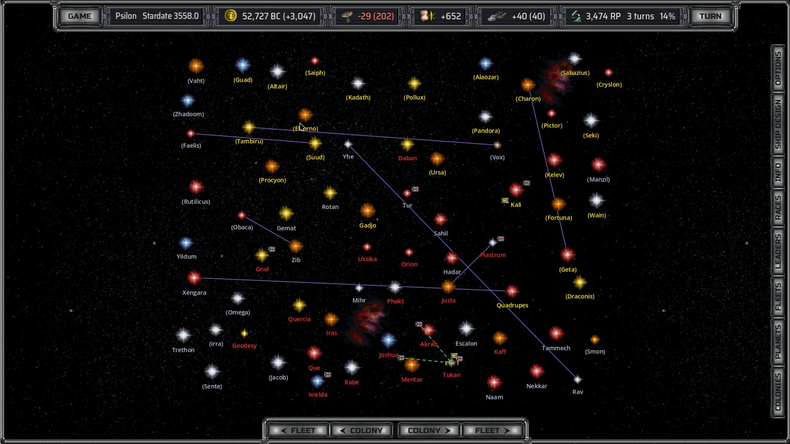

**Version 0.8.0** for Windows, Linux and (experimental) Apple Silicon macOS is on the
[releases page](https://github.com/Crono141/battle-at-antares/releases): an installer for each
system, and a setup that finds your Master of Orion II by itself. You need your own copy of
Master of Orion II 1.31 (GOG or Steam); if you don't have it installed, the setup can get it for
you from GOG or Steam.

If you enjoy it, you can support the work on [Ko-fi](https://ko-fi.com/crono141).

## The new interface

Every panel works through the same rules code the original screens use, so the game plays exactly
as Master of Orion II does, and saves, mods and multiplayer are unchanged.

**The galaxy** is the home view. The wheel zooms smoothly, a drag pans, and wide screens show more
of the galaxy. Influence borders, fleets with their routes and arrival times, and the map's hidden
keys as buttons. The top bar keeps your treasury, tax rate, command points, food, freighters and
research one click away.

**Systems and colonies.** Click a star and the camera flies to it; its planets come out on their
orbits and the system pane lists its fleets, governor and planets. Click a colony and its pane opens
beside the planet: production, morale, the population at work, defences and buildings, with the
build list (drag to reorder, refits included) next to it.

<table>
<tr>
<td>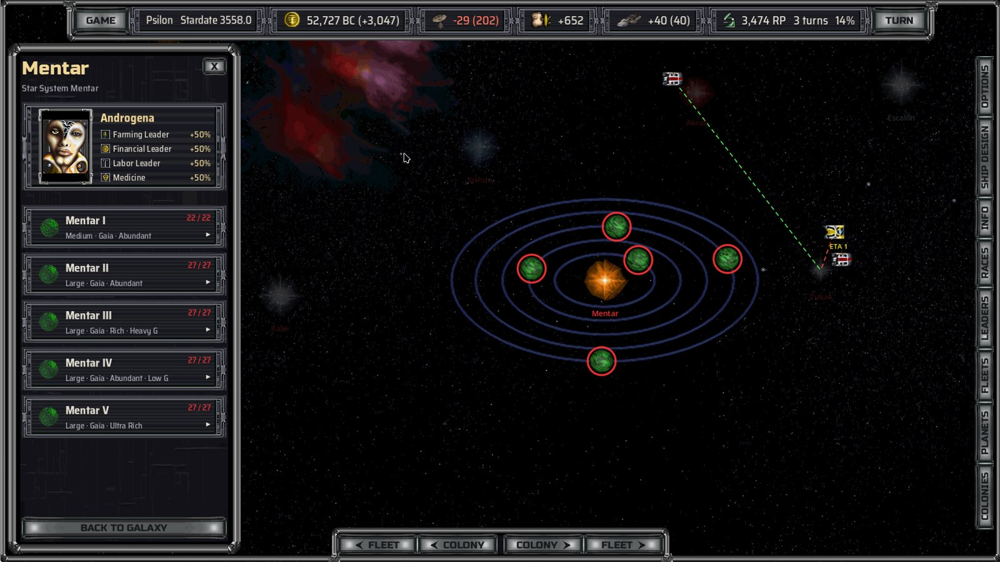</td>
<td>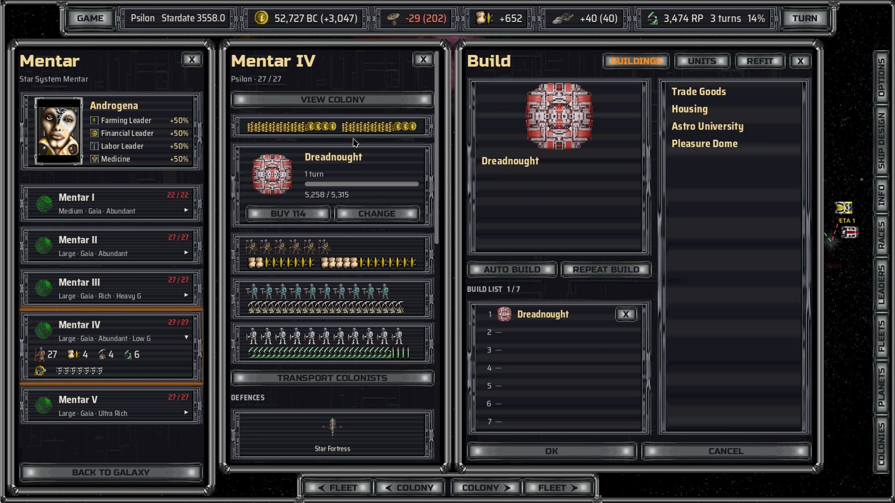</td>
</tr>
<tr>
<td align="center">A system, zoomed in from the map</td>
<td align="center">A colony and its build list</td>
</tr>
</table>

**Your empire** slides out from the right edge while the galaxy stays in view: Colonies, Planets,
Fleets, Leaders, Races and Info, each sortable.

<table>
<tr>
<td>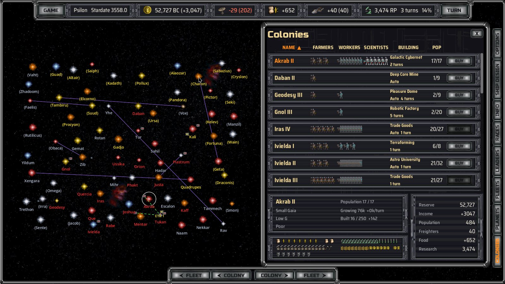</td>
<td>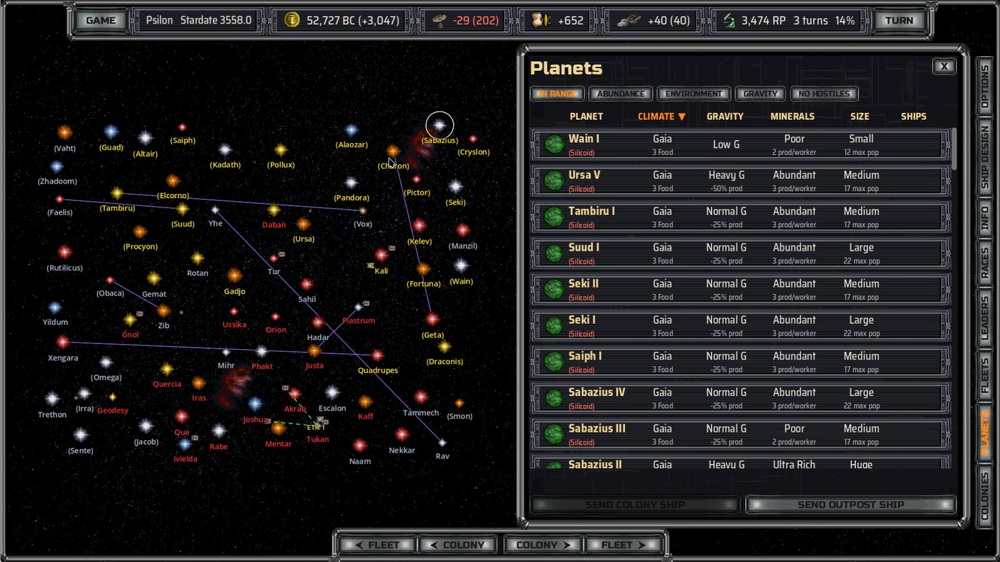</td>
</tr>
<tr>
<td align="center">Colonies</td>
<td align="center">Planets</td>
</tr>
<tr>
<td>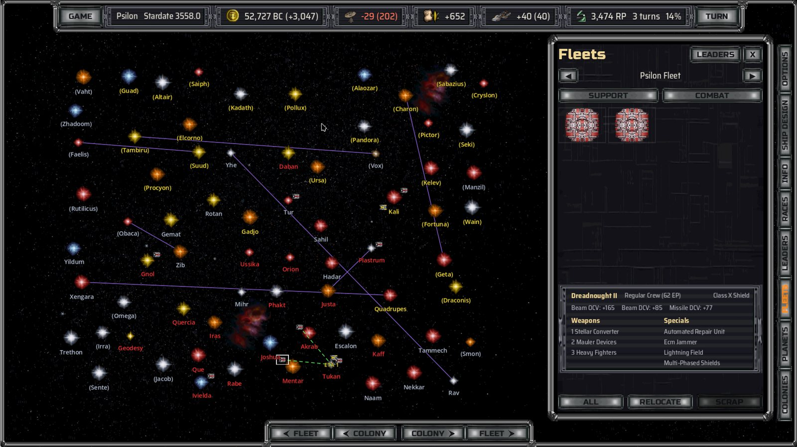</td>
<td>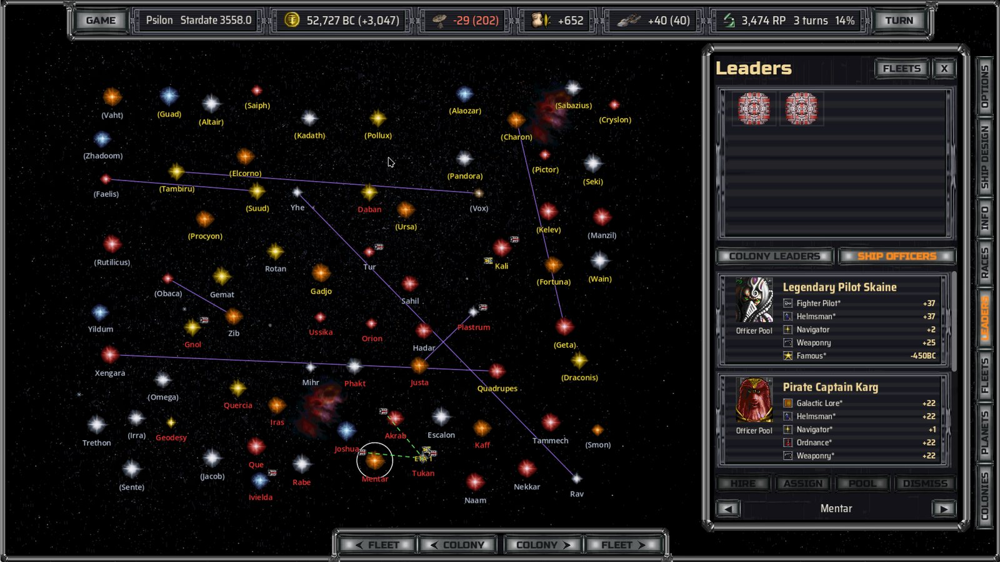</td>
</tr>
<tr>
<td align="center">Fleets</td>
<td align="center">Leaders: ship officers</td>
</tr>
<tr>
<td>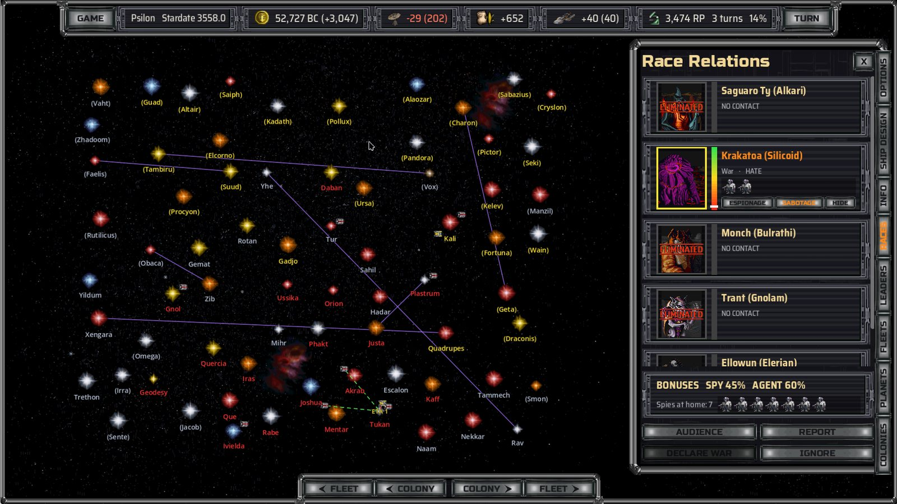</td>
<td>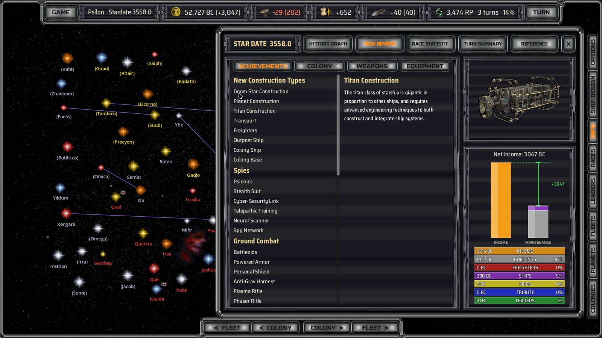</td>
</tr>
<tr>
<td align="center">Races</td>
<td align="center">Info</td>
</tr>
</table>

**Ship design** is a panel too: pick the hull and picture, fit drives, armour, shields and
computers, add weapons with their arcs and mods and the specials, and watch the space and cost as
you build.

<table>
<tr>
<td>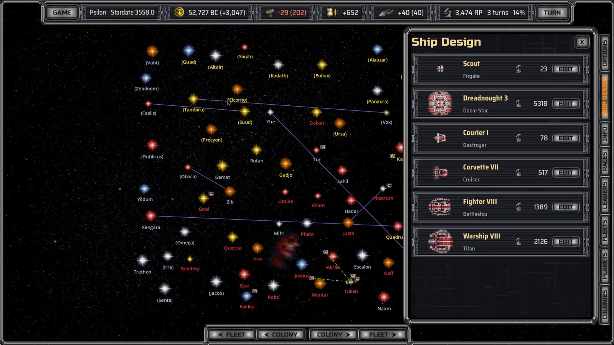</td>
<td>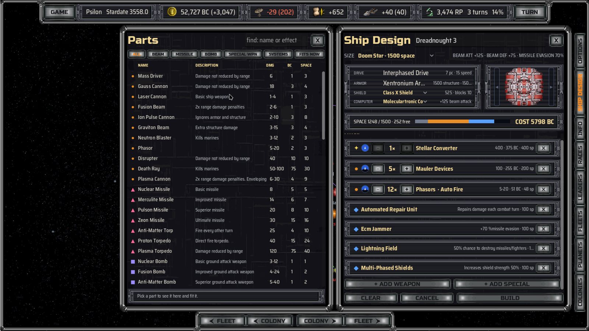</td>
</tr>
<tr>
<td align="center">Your designs</td>
<td align="center">Designing a doom star</td>
</tr>
</table>

**Space combat** plays in the new interface too. The rules are the original game's, unchanged;
the ships, beams, missiles, fighters and specials are drawn the way the original draws them, at
the screen's full resolution, with their sounds. Pan and zoom the field, and the camera follows each
shot. An initiative bar shows who moves next, a combat log records every hit, and holding the right
button anywhere opens the order ring (wait, done, retreat, board, scan, self destruct). Each weapon
can be set Ready, Held for a volley, or Off. Three layouts, picked under the battle's Options:
**Clear Field** (a slim HUD round the field), **Bridge** (your ship's card and a minimap down the
left) and **Command Console** (your ship and weapons along the bottom, both fleets on the right, and
the combat log).

<table>
<tr>
<td>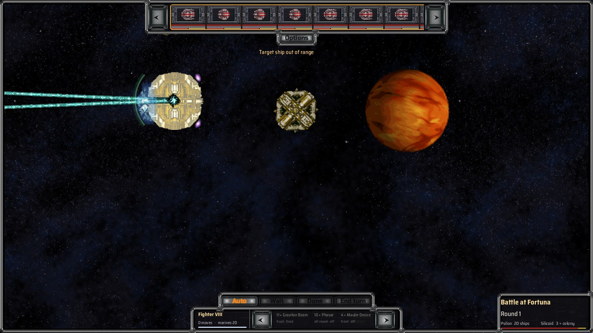</td>
<td>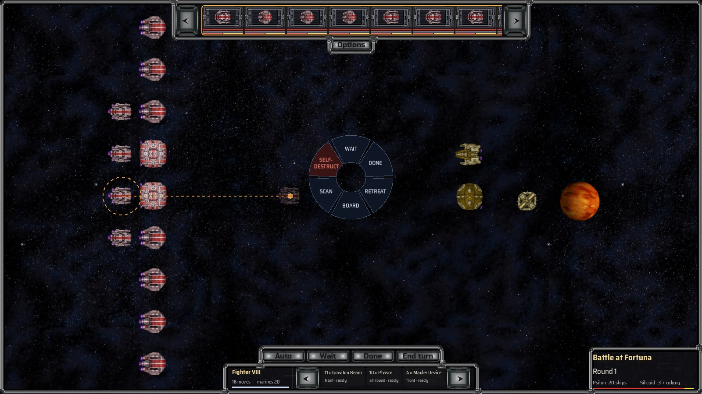</td>
</tr>
<tr>
<td align="center">Beams on a star base's shield</td>
<td align="center">The order ring</td>
</tr>
<tr>
<td>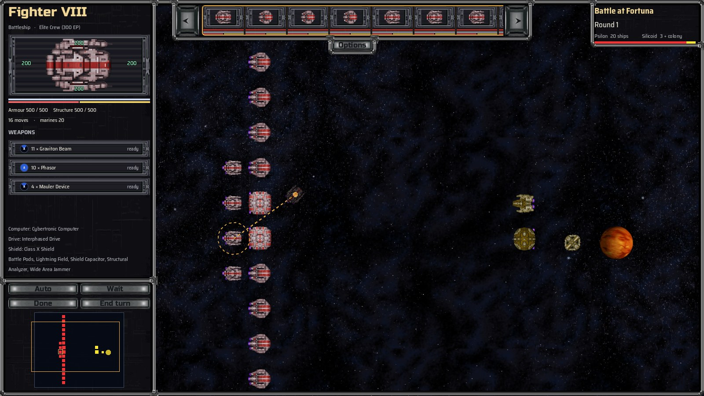</td>
<td>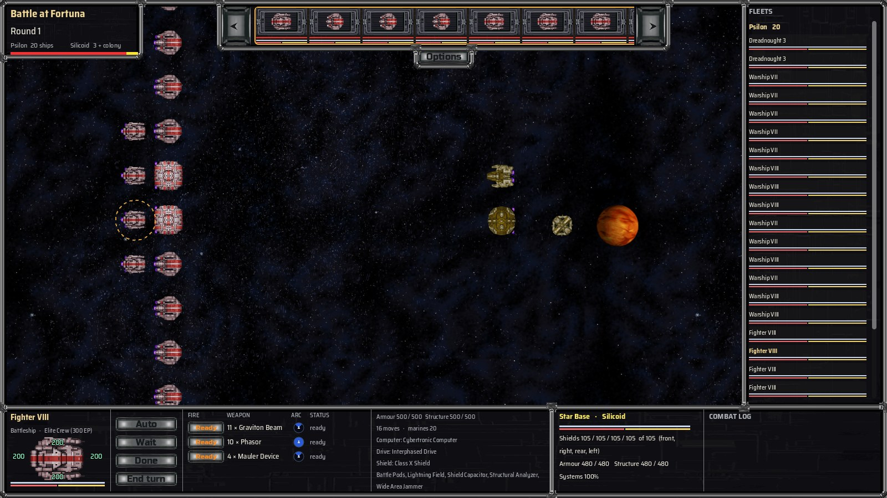</td>
</tr>
<tr>
<td align="center">Bridge</td>
<td align="center">Command Console</td>
</tr>
</table>

**Less interruption.** A start-of-turn to-do list collects empty build queues, ships that arrived,
leader offers and news, instead of stopping the turn for each one. Turn notices, saving and loading,
leaders for hire, the turn summary, the battle target choice and the bombing and invasion choices
show over the map; diplomacy, the news and ground combat play in a window over it.

**Still the original screens:** only the main menu with its new-game setup, and the high scores.
The original interface everywhere is one setting away: **Legacy interface** in the launcher's
settings; in the game, Ctrl+G switches to it, battles included.

## Themes

Two themes come with the game, and the game's Options > Theme switches between them while you play:

- **Chrome** (the default): the original screens' metal, at a smaller size.
- **Glass**: dark glass panels with thin steel edges.

<table>
<tr>
<td></td>
<td>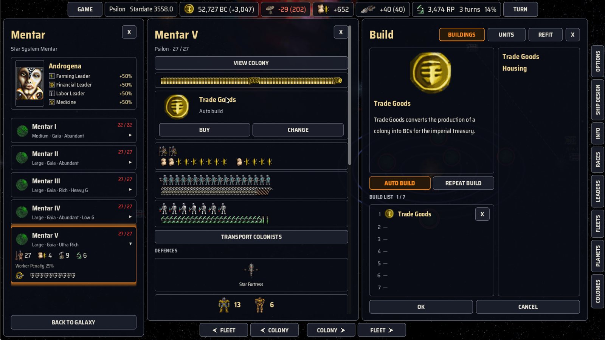</td>
</tr>
<tr>
<td align="center">Chrome</td>
<td align="center">Glass</td>
</tr>
</table>

A theme is an ordinary package (`data/mods/antares-ui-chrome.zip`, `antares-ui-glass.zip`): unzip a
copy of one to make your own. Themes never affect saves. Changing the layout itself is possible
too: [UI packages](docs/content/authoring-mods/ui-packages.md) explains how.

## Installing

You need your own copy of **Master of Orion II, version 1.31**: GOG or Steam (both are 1.31), or a CD
install patched to 1.31. Battle at Antares comes without the original game's files; the first time
it starts, its setup finds your copy and takes what it needs from it.

### 1. Install Battle at Antares

Download the file for your system from the
[releases page](https://github.com/Crono141/battle-at-antares/releases):

| System | Download | How |
|---|---|---|
| Windows 10 or 11 | `...-windows-x86_64-setup.exe` | Run it. It installs for your user only (no administrator needed), with a Start menu entry and, if you tick it, a desktop icon. Uninstall from Settings > Apps. |
| Linux, any desktop | `...-x86_64.AppImage` | Make it executable (`chmod +x`, or the file's Properties) and run it. The setup's last page offers to add it to your applications menu. |
| Linux, Flatpak | `...-x86_64.flatpak` | `flatpak install --user battle-at-antares-0.8.0-x86_64.flatpak`, then start it from your menu or with `flatpak run io.github.crono141.battle-at-antares`. Needs Flathub's GNOME runtime, which Flatpak fetches. |
| macOS 11 or later, Apple Silicon | `...-macos-arm64.dmg` | Open it and drag **Battle at Antares** into Applications. See [the first start on a Mac](#the-first-start-on-a-mac). |

Rather not install anything? The `.zip` (Windows) and `.tar.gz` (Linux) archives are the same game
as a folder: extract it anywhere you can write to and start `antares-launcher`. That folder then holds
everything, saves and settings included.

**Windows says "Windows protected your PC"**: the programs aren't signed. Click More info, then Run
anyway.

### 2. The setup finds your game

The first start opens the setup in the launcher. It looks for Master of Orion II on its own:

- **Installed copies:** GOG (GOG Galaxy and the GOG installer's folders), every Steam library, Heroic,
  Lutris and Wine prefixes, and on a Mac the Applications folder.
- **GOG's offline installers in your Downloads folder:** the Linux `.sh` and the Mac `.pkg` are read
  directly, nothing needs installing; on Windows the setup runs GOG's `.exe` for you and waits.
- **Anywhere else:** "Choose a folder..." or "Choose an installer...".

Pick the copy it lists first, or another, and the setup checks it (every file there, version 1.31),
copies the game files it needs (about 300 MB) into Battle at Antares's own folder, offers to bring
your saves along, and offers the HD art. Your Master of Orion II stays exactly as it was: keep
playing it, or uninstall it later.

**Don't have it installed?** Choose "I don't have it yet":

- **Steam:** the setup opens Steam's install for Master of Orion 2 and carries on by itself when
  Steam has finished.
- **GOG, signed in here:** GOG's own sign-in page opens in a small window (with "continue with
  Google" and the rest), and the setup downloads the offline installer into your Downloads and uses
  it. You type your password into GOG's page, never into Battle at Antares, and nothing of the
  sign-in is kept afterwards.
- **GOG's website:** download the offline installer yourself; the setup notices it in Downloads.

The **Game files** button in the launcher opens the setup again at any time, for instance to switch
to another copy.

### Where your files live

The installed versions keep saves, settings, logs and the copied game files in your user folder,
so a reinstall or an update never touches them:

| System | Folder |
|---|---|
| Windows | `%APPDATA%\Battle at Antares\` |
| Linux (installed or AppImage) | `~/.config/antares/`, `~/.local/share/antares/` (saves, game files, mods), `~/.local/state/antares/` (logs) |
| Linux (Flatpak) | the same, under `~/.var/app/io.github.crono141.battle-at-antares/` |
| macOS | `~/Library/Application Support/Battle at Antares/` |

The `.zip` and `.tar.gz` archives keep everything in their own folder instead.

**Saves** from the original game (`SAVE1.GAM` to `SAVE10.GAM`) and from Orion2 Redone load: the setup
offers to import the ones it finds next to your copy, or put them into the saves folder above.

### Updates

The launcher checks for a new release when it starts (you can switch that off in its Settings).
When one is out, an **Update** button appears beside the version in its title: the Windows
installer, the Windows and Linux archives and the AppImage download the new version, install it
and start again, keeping your saves, settings and HD art. The Flatpak and the Mac version open the
release page.

### The first start on a Mac

The Mac version isn't signed by Apple (experimental: built and checked on GitHub's Mac machines,
not yet played much on a real Mac, so reports are welcome). macOS stops it the first time:

1. Open Battle at Antares from Applications. macOS says it can't check it; click Done.
2. Open **System Settings > Privacy & Security**, scroll down, and click **Open Anyway** next to
   Battle at Antares. Confirm, and it starts. From then on it opens normally.

Or, in Terminal: `xattr -dr com.apple.quarantine "/Applications/Battle at Antares.app"`.

### If it doesn't start

- *The setup can't find your copy:* use "Choose a folder..." and pick the folder with `ORION95.EXE`
  and a few hundred `.LBX` files (on Steam: right-click the game, Manage > Browse local files, then its
  `data` folder), or "Choose an installer..." for a GOG offline installer.
- *Nothing happens on Linux:* start it from a terminal to see why (`./antares-launcher` in an
  archive's folder, or the AppImage by its path).
- Still stuck? The game writes logs (`logs/` in the folders above, or in an archive's folder). Please
  [open an issue](https://github.com/Crono141/battle-at-antares/issues) and attach the latest.

**HD art** (optional, recommended): the setup's HD art page downloads the packs from
[battle-at-antares-hd](https://github.com/Crono141/battle-at-antares-hd/releases) for you, and the
launcher's **HD art** button does the same later. Downloaded by hand, they go into the `mods` folder
(in the folders above, or `data/mods/` in an archive's folder) as they are; tick them in the launcher. Every sprite, the diplomacy rooms and the
cutscenes are redrawn or upscaled for today's screens. They are art only and never affect saves.

## Also different from Redone

- **HD rendering.** The drawing library works at two resolutions: the original 640x480 palette
  screen stays authoritative for game logic, and every draw also renders at 4x with HD art where a
  pack provides it. Making an art pack: [art packs](docs/content/authoring-mods/art-packs.md).
- **A launcher** (`antares-launcher`): the first-start setup, tick packages, keep named profiles,
  see which mods a save needs, change settings, download the HD art, update, and play. Its look
  follows the themes (Settings > Launcher look: Chrome or Glass).
- **Mouse wheel** scrolls every list; **Ogg Vorbis** music works in mods.
- **Mods.** Redone's mods load (`requires.engine` still checks Redone's mod API, 2.x); packages that
  need Antares features add `requires: { antares: ">=0.5.0" }`. Art-only packages are not recorded in
  saves, so turning one on or off never stops a save from loading.
- **Identity.** The game is `antares-godot` (the native interface) and `antares` (the original
  screens only); the config file is `data/antares.cfg` (an existing `orion2re.cfg` is read on first
  run); environment knobs are `ANTARES_*`.
- **Online multiplayer is off by default.** Redone's community router belongs to Redone; set
  `interface router` to a router you run. Hotseat and LAN play work as before.

## What's next

0.9: the title screen, the new-game setup and the high scores in the new interface, the last of the
original screens. Reports on the new battles are very welcome: odd fights (monsters, Antarans, big fleets, heavily defended
planets) most of all.

## Credits

Almost everything that makes this game play like Master of Orion II is the work of the **Orion2
Redone** project: Serge Koval, Christopher Wellons, Rocco and the other Redone contributors. Their
restoration of the game rules, AI, combat, saves and mod system is what Battle at Antares builds on,
and their fixes are merged here as they land. Please support and credit their project. Report Battle
at Antares bugs [here](https://github.com/Crono141/battle-at-antares/issues), not to Redone.

The native interface is made with [Godot](https://godotengine.org) (MIT). The themes' lettering is
Russo One and Saira Semi Condensed (SIL Open Font License).

Battle at Antares is developed with AI assistance under human direction: the owner sets the design,
reviews and plays every change, and is responsible for the result.

## Building from source

Clone with submodules (`git clone --recurse-submodules`), then build with CMake presets (CMake 3.20+,
Ninja):

```sh
cmake --preset linux-release && cmake --build --preset linux-release   # antares, antares-launcher
cmake --preset linux-godot && cmake --build --preset linux-godot       # libantares for the Godot build
```

The native interface is the Godot 4.7 project in `frontend/godot/project/`: open it in the Godot
editor with `libantares` built, set the game folder (`ANTARES_GAME_DIR`), and run. Windows builds
cross-compile with the `mingw-win64-release` preset; macOS uses `osx-release`. Unit tests:
`tools/run-tests.sh`. Redone's own README covers the engine's build options in more detail:
[orion2re/README.md](https://github.com/orion2re/orion2re/blob/main/README.md).

## Licence

GPLv3 or later, as Redone (see [`LICENSE`](LICENSE)). You need your own copy of Master of Orion II;
no original game files are in this repository. The screenshots in `docs/screenshots/` show the
game's art for illustration; the Chrome theme in the downloads carries metal cut from the game's
screens. Master of Orion II and its assets belong to their owners.
